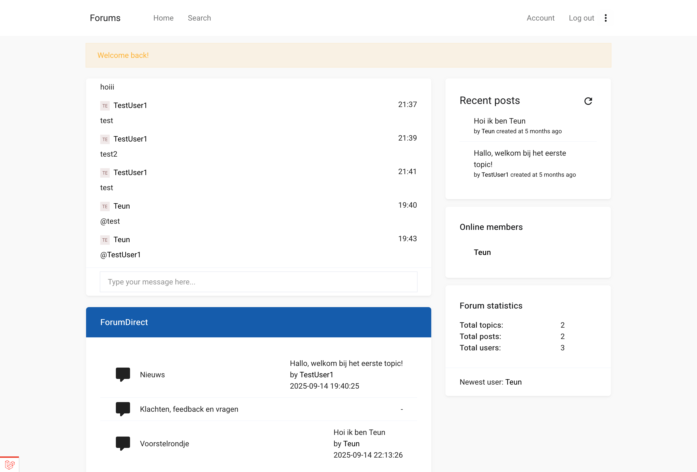
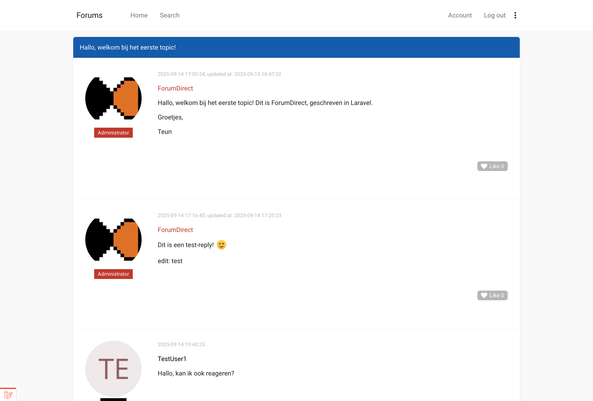
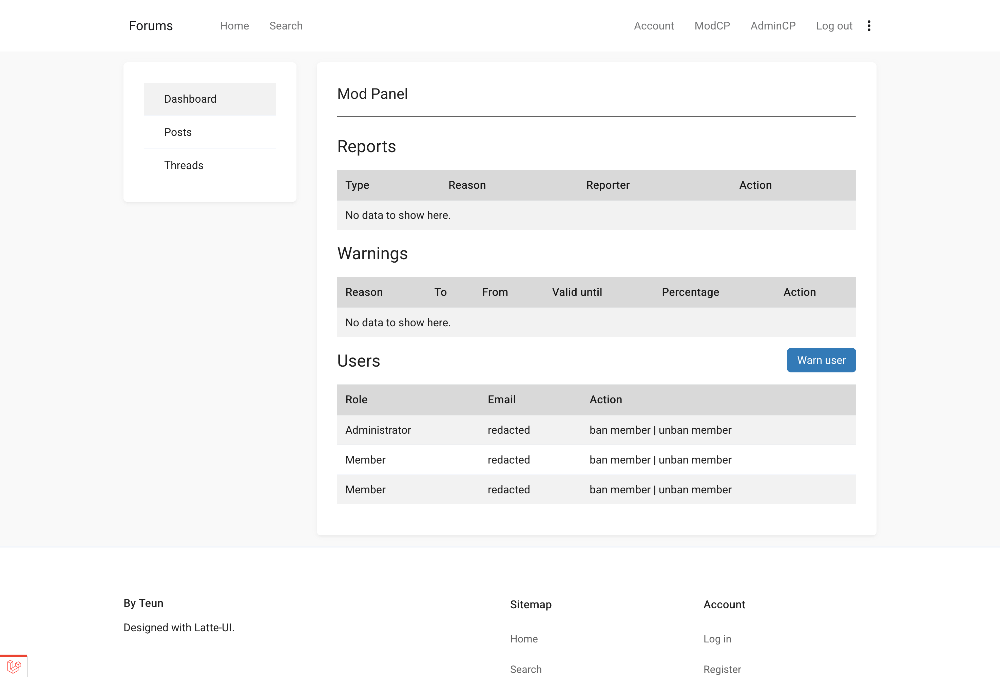
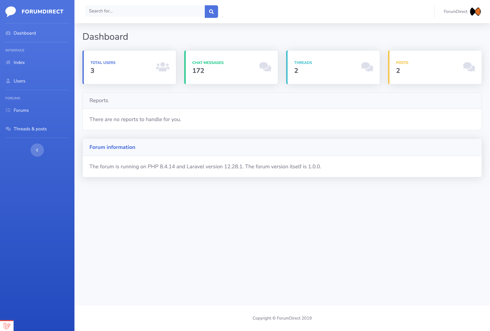

# ForumDirect

A minimalist and easy to use discussion board system made in Laravel. 

Uses RBAC to restrict actions and includes many features such as a chat client and the ability to vote on posts.

## Set-up instructions

* `Clone the code`
* `Navigate to the working directory`
* `Run composer install`
* `Rename .env.example and change the settings (i.e. DB, URL, etc)`
* `Run php artisan migrate --force`
* `Run php artisan db:seed`

## Chat instructions

* `Run npm install`
* `Run php artisan install:broadcasting`
* `You may want to change some settings in the .env file`
* `Run php artisan reverb:start to start the broadcast server`

## Screenshots

## License
ForumDirect is licensed under the MIT license.
